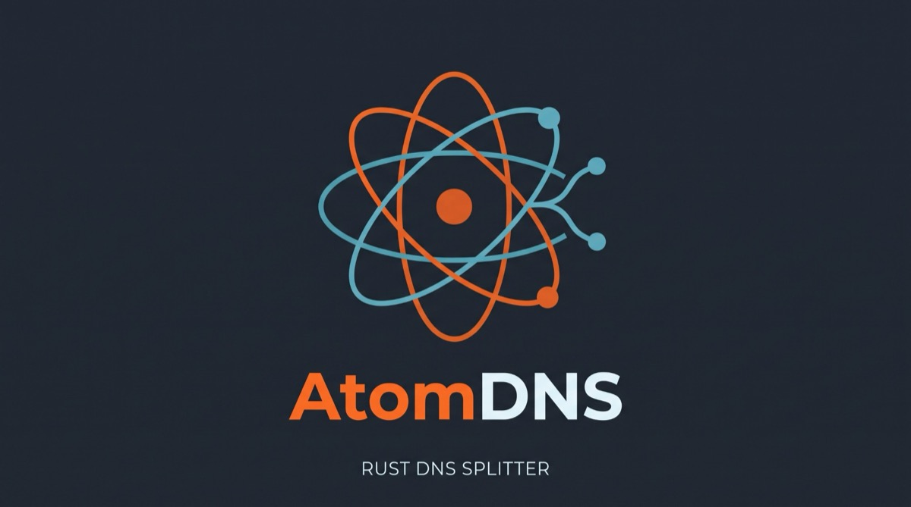

<p align="center"></p>

# atomdns

**AtomDNS**（程序名 `atomdns`，前身 rtdns）是 [MosDNS](https://github.com/yyysuo/mosdns) 的纯 Rust 重写：一个面向家庭网络、旁路由和透明代理环境的 DNS 分流程序，
带 Vue WebUI，保持 MosDNS 的配置（YAML、`sequence`/插件语义）、DNS 分流结果、WebUI/API 工作流和持久化格式不变。
构建只需要 Rust 工具链（WebUI 打包用 Node），没有 Go 源码、不需要 Go 工具链。

## 与 MosDNS 的关系

- AtomDNS 的行为目标是 MosDNS-T（[`jasonxtt/mosdns`](https://github.com/jasonxtt/mosdns)，基于 `yyysuo/mosdns` 持续维护的分支）：
  同样的配置、同样的专属分流组、在线规则、查询日志与 WebUI，用 Rust 重新实现运行时。
  Go 版仍在 `jasonxtt/mosdns` 维护；它的安装脚本、Docker 镜像和 OpenWrt 软件源**不在本仓库**，本仓库也不提供这些发行形式。
- 本仓库从 2026-10-21 起独立，保留 `jasonxtt/mosdns` 的 `rust` 分支的完整历史。
- 2026-10-30 起项目更名为 AtomDNS：程序、crate（`atomdns-*`）、`ATOMDNS_*` 环境变量、`atomdns_*` 指标名、发布资产与更新来源（`jasonxtt/atomdns`）都用新名字。
  配置包标识（`channel "rust"`、`rust-config-schema-N`、`config_rust_up.zip`）和缓存转储格式名 `mosdns_cache_v2` 沿用旧名（持久化格式）。

## 主要能力

- 国内外域名分流、FakeIP / Redir-Host 两种模式；白名单、灰名单、DDNS 域名、重定向等名单维护。
- 专属分流组：命中某组的域名交给绑定的专属上游和专属缓存。
- 在线规则订阅、本地规则、查询日志与诊断、缓存管理。
- WebUI（`/`）：从 v0.4.0 起是配置目录下的 `ui/main/`（Release 资产 `atomdns-webui.tar.gz`，全新安装包自带），不放就是纯后端；其它 `ui/<name>/` 也可放 UI 包，见 [external-ui.md](docs/rust/external-ui.md)。
- 带自动回滚的在线更新（程序、配置包与已安装的 WebUI 一起），见 [native-update.md](docs/rust/contracts/native-update.md)。

## 安装与在线更新

目前只发布 **Linux amd64** 程序，没有安装脚本。

1. 从本仓库的 [Releases](https://github.com/jasonxtt/atomdns/releases) 下载 `atomdns-linux-amd64.tar.gz` 与 `atomdns-update-manifest.json`，
   用清单核对 sha256，解出 `atomdns`，放到例如 `/usr/local/bin/atomdns`。
2. 准备配置目录（例如 `/cus/atomdns`，里面是 `config_custom.yaml` 等文件；配置规则见 [config-notes.md](docs/ai/config-notes.md)）。
   要 WebUI 就把同一 Release 的 `atomdns-webui.tar.gz` 解到 `/cus/atomdns/ui/main/`（全新安装包 `config_rust.zip` 已自带）。
   从 Go 版 MosDNS 迁移的历史切换流程见 [cutover.md](docs/rust/cutover.md)（该工具按旧程序名编写，仅作参考）。
3. 用 systemd 管理，例如：

   ```ini
   [Service]
   ExecStart=/usr/local/bin/atomdns start -d /cus/atomdns -c config_custom.yaml
   Restart=always
   ```

   命令行：`atomdns start [-d <dir>] -c <config>`、`atomdns check [-d <dir>] -c <config>`（只检查配置）、`atomdns version`。
4. 在线更新：WebUI「系统设置」检查更新并“立即更新”。更新只来自 `jasonxtt/atomdns` 的 `vX.Y.Z` 发布，
   程序、（需要时的）配置包和（已安装时的）WebUI 都经 sha256 校验，新程序在守护进程下试运行，不健康会自动回滚到旧程序、旧配置和旧界面。

## 构建

```bash
scripts/build-rust-native.sh          # 构建程序（不含 WebUI），输出 release/atomdns-native
(cd webui-log && npm ci && npm run build:package)   # WebUI 包 release/atomdns-webui.tar.gz
scripts/build-rust-release.sh vX.Y.Z  # 程序包、WebUI 包与更新清单（只构建，不发布）
cargo test --workspace --no-fail-fast --manifest-path rust/Cargo.toml
```

发版与手动替换步骤见 [release.md](docs/rust/release.md)。

## 文档

- [不使用 WebUI：持久设置、校验与生效](docs/rust/headless.md)
- [AGENTS.md](AGENTS.md)、[项目背景](docs/ai/project-context.md)、[配置说明](docs/ai/config-notes.md)
- [产品契约](docs/rust/contracts/index.md)、[验证摘要](docs/rust/validation-summary.md)
- [发版与手动替换](docs/rust/release.md)、[Go→Rust 切换（历史）](docs/rust/cutover.md)
- 与上游 MosDNS 的同步范围：[UPSTREAM_SYNC.md](UPSTREAM_SYNC.md)

## 开源协议

本项目采用 **GNU General Public License v3.0（GPL-3.0）**，见 [LICENSE](LICENSE)。使用、修改和再发布时请保留原作者及相关版权声明。

## 致谢

基于 [`yyysuo/mosdns`](https://github.com/yyysuo/mosdns) 及其维护分支 [`jasonxtt/mosdns`](https://github.com/jasonxtt/mosdns)，感谢原项目作者及所有贡献者。
